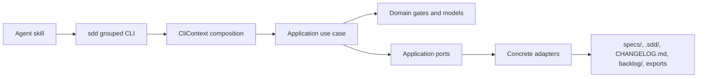

# SDD Harness Architecture And Package Guide

This package is a Clean Architecture TypeScript CLI harness for strict spec-driven development. It is built as a portable workflow engine, not an agent-specific prompt pack: Markdown specs are the canonical artifacts, `.sdd/*` stores machine-readable workflow state and evidence, and skills are thin wrappers that delegate to `sdd`.

## Purpose And Development Model

The harness enforces the course workflow as executable policy:

1. Capture stakeholder thoughts and JTBD context.
2. Create and approve a constitution.
3. Clear context and create feature specs from the roadmap.
4. Validate and approve specs before implementation.
5. Implement through TDD task groups, with strict red/green/refactor sequencing evidence when strict mode is used.
6. Create a semantic contract, then run validation, deep review, semantic verification, review decisions, changelog, and merge-readiness gates.
7. Replan, plan MVP, and maintain local skills through explicit workflow commands.

The core design rules are:

- Domain code owns pure models and gate policy.
- Application use cases own workflow orchestration.
- Ports define dependencies such as filesystem, git, telemetry, test runners, browser QA, database sandboxing, and review agents.
- Adapters implement those ports.
- The CLI composes adapters and routes grouped commands.
- Skills do not contain business logic; they gather context, persist question evidence, and call the CLI.

## Repository Map

| Path | Purpose |
| --- | --- |
| `src/` | Source implementation. |
| `src/domain/` | Models, workflow step definitions, validation policy, errors, and slug helpers. |
| `src/application/` | Use cases and ports. |
| `src/adapters/` | Filesystem, Markdown spec store, workflow state store, git, validation runner, browser QA, database sandbox, telemetry, and export adapters. |
| `src/interfaces/cli/` | Argument parsing, dependency composition, and grouped command routing. |
| `src/bin/` | Executable `sdd` entrypoint. |
| `skills/` | Agent skill wrappers over CLI workflows. |
| `tests/` | Unit, integration, and e2e coverage for domain policy, use cases, adapters, skills, and CLI workflows. |
| `docs/` | Package documentation. |
| `dist/` | Generated build output; not source. |
| `package.json` | Package metadata, binary mapping, and scripts. |
| `package-lock.json` | Locked npm dependency graph. |
| `tsconfig.json` | Strict TypeScript config for source and tests. |
| `tsconfig.build.json` | Build-only config for `src/`. |
| `vitest.config.ts` | Vitest configuration. |

## Source Architecture



### Domain

`models.ts` defines JTBD, constitution, roadmap phases, feature specs, semantic contracts, task groups, validation cases, gates, evidence, TDD phase evidence, telemetry traces, brownfield profiles, metadata, workflow state, question evidence with prompt IDs and prompt hashes, approvals, checkpoints, task-group progress, validation summaries, semantic verification summaries, structured review findings, MVP retrospectives, branch records, prompt templates, and experience-flow coverage models.

`workflow.ts` defines the 20 course steps plus brownfield discovery, their automation levels, required evidence, initial state, state merging, next-step selection, and grouped question evidence gates.

`prompt-catalog.ts` is the canonical course prompt catalog. Skills and agents should render these prompts instead of carrying separate copies of the workflow instructions.

`spec-validation.ts` validates constitution Markdown, feature Markdown, UI-work detection, database-work detection, and default validation command discovery. `semantic-validation.ts` validates semantic contracts, `semantics.md`/JSON hash consistency, scenario oracles, evidence mappings, UI flow mappings, data evidence, and telemetry applicability.

### Application

`ports.ts` defines interfaces for filesystem, spec store, workflow state store, prompt catalog, git, agent runner, user-question tool, test runner, browser QA, database sandbox, docs lookup, issue tracker, review agents, telemetry, clock, and IDs.

Use cases include stakeholder setup, JTBD intake, constitution create/validate/approve, brownfield discovery, branch-gated feature create/revise/semantic-contract/validate/approve/plan/implement/complete, validation, command-backed deep review, semantic verification, review decisions, replanning, changelog, MVP retro, prompt list/show/render, workflow status/next/doctor/checkpoint/branch, skill validate/scaffold, exports, and research backlog.

`UserQuestionPort`, `DocsLookupPort`, and `IssueTrackerPort` remain optional ports. The current hard-gated CLI path uses persisted grouped question evidence files instead of invoking a live question tool directly. Config-backed docs and issue tracker adapters read `.sdd/docs-lookup.json` and `.sdd/issue-tracker.json`; `workflow doctor --strict` reports them as required readiness checks.

`AgentProviderPort` wires Codex and Claude through command-backed adapters. Provider config is stored in `.sdd/agents.json`; guided workflows use providers for draft thinking and question evidence while the existing use cases keep ownership of gates and artifact writes.

`OrchestratorStorePort` persists the CLI-first orchestration control plane. The orchestrator reads existing workflow state, applies per-step ownership policy, pauses on human-owned decisions, runs harness-owned gates, delegates bounded semantic drafting, implementation, refactor, and repair packets to Codex or Claude, and records resumable run state without letting the agent decide when work is complete.

### Adapters

- `spec/markdown-spec-store.ts`: canonical Markdown spec persistence and `.sdd/metadata.json`.
- `workflow/json-workflow-state-store.ts`: `.sdd/workflow-state.json` plus JSONL artifacts for questions, approvals, checkpoints, task groups, TDD phase evidence, validation summaries, review summaries, review decisions, MVP retros, branch actions, roadmap updates, and waivers.
- `prompts/static-prompt-catalog.ts`: adapter over the canonical prompt catalog.
- `git/child-process-git.ts`: repository checks, branch, dirty status, branch creation, and changelog commit reads.
- `testing/command-test-runner.ts`: validation command execution with sandbox env vars and `.sdd/evidence/*.log`.
- `browser/playwright-coverage-adapter.ts`: checks for Playwright workflow coverage, validates that every `experience.md` flow maps to a concrete Playwright test file and title with route/screen, visible outcome, and mutation evidence, scans routes/pages/app-style UI inventory for unmodeled routes and form-submit workflows, and verifies that mapped test titles appeared in successful Playwright command evidence.
- `database/file-database-sandbox.ts`: copies a database file into `.sdd/test-db/` and exposes the copy to validation commands through `DATABASE_URL`, `SDD_TEST_DATABASE`, or a caller-provided env key. It also supports command-backed sandboxes from `.sdd/database-sandbox.json` for non-file databases.
- `database/command-database-mutation-verifier.ts`: runs `.sdd/database-mutation-verifier.json` command templates against expected mutations from `experience.md` and the semantic contract, writing expected-mutation JSON plus verifier logs under `.sdd/evidence/`.
- `docs/config-docs-lookup.ts` and `issues/config-issue-tracker.ts`: optional config-backed readiness adapters for local docs and open issue context.
- `testing/command-review-agent.ts`: launches portable command-backed review agents from `.sdd/review-agents.json` or the configured `.sdd/agents.json` Codex/Claude provider, then writes per-lens JSON/Markdown review artifacts.
- `testing/command-semantic-verifier.ts`: launches portable command-backed semantic verifiers from `.sdd/semantic-verifiers.json` or the configured `.sdd/agents.json` provider, then writes per-dimension JSON/Markdown verification artifacts.
- `testing/static-review-agent.ts`: compatibility fallback adapter retained in source, but not the default CLI review path.
- `telemetry/jsonl-telemetry-sink.ts`: `.sdd/telemetry.jsonl` and `.sdd/evidence.jsonl`.
- `spec/openspec-adapter.ts` and `spec/spec-kit-adapter.ts`: secondary export views.
- Brownfield discovery writes additive extracted signals such as package script command maps, validation command candidates, route summaries, database schema or migration summaries, and UI entry candidates into `.sdd/brownfield-profile.json`.

## Grouped CLI Commands

All commands accept `--project <path>`.

- `sdd stakeholder setup`
- `sdd jtbd intake`
- `sdd constitution create`
- `sdd constitution validate`
- `sdd constitution approve`
- `sdd brownfield discover`
- `sdd feature create`
- `sdd feature revise`
- `sdd feature semantics`
- `sdd feature validate-spec`
- `sdd feature approve`
- `sdd feature plan-tdd`
- `sdd feature implement`
- `sdd feature record-tdd`
- `sdd feature complete-task-group`
- `sdd feature run-validation`
- `sdd feature deep-review`
- `sdd feature semantic-verify`
- `sdd feature review-decisions`
- `sdd feature complete`
- `sdd replan create`
- `sdd replan impact`
- `sdd changelog update`
- `sdd mvp plan`
- `sdd mvp retro`
- `sdd workflow status`
- `sdd workflow next`
- `sdd workflow doctor`
- `sdd workflow checkpoint`
- `sdd workflow branch`
- `sdd workflow greenfield`
- `sdd orchestrator init`
- `sdd orchestrator configure`
- `sdd orchestrator run`
- `sdd orchestrator status`
- `sdd orchestrator resume`
- `sdd agent configure`
- `sdd agent doctor`
- `sdd prompt list`
- `sdd prompt show`
- `sdd prompt render`
- `sdd skill validate`
- `sdd skill scaffold`
- `sdd export openspec`
- `sdd export speckit`
- `sdd research backlog`

Spec-writing commands require persisted grouped question evidence through `--questions <file>`. Evidence must include the expected workflow, canonical prompt ID, and current prompt hash. The old loose `--answers` path is intentionally removed because this is a new project and hard question evidence is part of the workflow.

Feature and MVP spec-writing commands require matching branch evidence from `sdd workflow branch --purpose feature|mvp --name "<name>"` before files are written. The recorded branch action is matched by purpose/name and verified against the current git branch; waivers require both `--waiver-reason` and `--approved-by`.

Feature and MVP spec-writing commands also require four grouped answers: scope, decisions, context, and experience. The experience answer is the source of truth for UI QA. For non-UI features it must explicitly say that no UI-facing experience exists. For UI features it must provide `FLOW-*` entries with role, route/screen, happy path, edge/error states, data setup, database mutations, expected visible outcome, and Playwright mapping.

## Generated Artifacts

Canonical specs:

- `specs/jtbd.md`
- `specs/mission.md`
- `specs/tech-stack.md`
- `specs/roadmap.md`
- `specs/YYYY-MM-DD-feature-name/requirements.md`
- `specs/YYYY-MM-DD-feature-name/plan.md`
- `specs/YYYY-MM-DD-feature-name/validation.md`
- `specs/YYYY-MM-DD-feature-name/experience.md` for UI features, generated from the grouped experience interview
- `specs/YYYY-MM-DD-feature-name/semantics.md` semantic contract for actors, outcomes, entities, commands, states, invariants, scenarios, oracles, evidence, telemetry, and architecture claims
- `specs/YYYY-MM-DD-feature-name/tdd-plan.md`

Machine-readable state and evidence:

- `.sdd/metadata.json`
- `.sdd/workflow-state.json`
- `.sdd/question-evidence.jsonl`
- `.sdd/approvals.jsonl`
- `.sdd/checkpoints.jsonl`
- `.sdd/task-groups.jsonl`
- `.sdd/tdd-evidence.jsonl` for command-backed red, green, and refactor phase evidence
- `.sdd/validation-summaries.jsonl`
- `.sdd/review-summaries.jsonl`
- `.sdd/semantic-contracts/*.json`
- `.sdd/semantic-verifications.jsonl`
- `.sdd/review-decisions.jsonl`
- `.sdd/mvp-retrospectives.jsonl`
- `.sdd/branch-actions.jsonl`
- `.sdd/roadmap-updates.jsonl`
- `.sdd/waivers.jsonl`
- `.sdd/prompts/*.md`
- `.sdd/agents.json`
- `.sdd/agent-runs/*`
- `.sdd/orchestrator.json`
- `.sdd/orchestrator-state.json`
- `.sdd/orchestrator-evidence/*`
- `.sdd/thinking/*.md`
- `.sdd/question-drafts/*.json`
- `.sdd/review-agents.json`
- `.sdd/database-sandbox.json`
- `.sdd/database-mutation-verifier.json`
- `.sdd/docs-lookup.json`
- `.sdd/issue-tracker.json`
- `.sdd/telemetry.jsonl`
- `.sdd/evidence.jsonl`
- `.sdd/evidence/*.log`
- `.sdd/evidence/*expected-db-mutations.json`
- `.sdd/implementation-packets/*.md`
- `.sdd/reviews/<feature>/<lens>.json`
- `.sdd/reviews/<feature>/<lens>.md`
- `.sdd/reviews/<feature>/prompts/<lens>.md`
- `.sdd/semantic/<feature>/evidence-packet.md`
- `.sdd/semantic/<feature>/<dimension>.json`
- `.sdd/semantic/<feature>/<dimension>.md`
- `.sdd/reviews/*.md`
- `.sdd/revisions/*.md`
- `.sdd/test-db/*.copy`

Other generated outputs:

- `CHANGELOG.md`
- `backlog/research/*.md`
- `openspec/changes/*`
- `.specify/*`

## Workflow Status Model

Step statuses are:

- `not_started`
- `ready`
- `in_progress`
- `blocked`
- `complete`
- `waived`

Automation levels are:

- `enforced`
- `guided`
- `manual_checkpoint`
- `not_implemented`

`sdd workflow status` reads `.sdd/workflow-state.json` and prints every course step, its status, automation level, command, blockers, and next command. `sdd workflow next` returns the first incomplete non-brownfield course step.

## Hard Gates

Current hard gates include:

- Constitution creation requires grouped question evidence for mission, target audience, tech stack, and roadmap.
- Feature and MVP spec creation require grouped question evidence for scope, decisions, context, and experience.
- Feature and MVP spec creation require prior `workflow branch` evidence for the matching purpose and name, and the current git branch must match the recorded branch unless an approved waiver is recorded.
- `workflow branch` refuses to create branch evidence from a dirty working tree unless `--allow-dirty` is explicitly provided.
- Non-UI feature specs must explicitly record that no UI-facing experience exists.
- UI feature specs require concrete `FLOW-*` experience entries before files are written and before approval.
- Final feature spec approval requires `semantics.md` and matching `.sdd/semantic-contracts/<feature>.json`.
- Semantic contracts require actors or explicit not-applicable rationale, outcomes, scenarios, oracles, invariant evidence, UI flow mappings, data evidence, and telemetry expectations or explicit not-applicable rationale.
- Feature implementation requires approved feature status.
- TDD planning, implementation, validation, review, and semantic verification require current spec files to match the latest feature approval snapshot; spec edits after approval require re-validation and re-approval.
- Orchestrator agent drafts must match the guided draft schema exactly; missing required fields, unknown fields, non-string answers, malformed questions, and malformed risks block before artifact writes.
- Orchestrator agent implementation phases are scope-checked; approved spec edits and changes outside the default implementation surface block before TDD evidence is recorded.
- Orchestrator red/green/refactor proof requires real source test files. Red must touch a real test path, green must share that path, and refactor cannot switch to unrelated test evidence. Synthetic orchestrator evidence is retained only as supporting context.
- Task group completion requires implementation evidence and test evidence unless explicitly waived.
- `sdd feature record-tdd` is the canonical strict TDD evidence path. Red phase commands must fail, green/refactor commands must pass, and every phase record stores the command, exit code, command evidence log, task-group mapping, validation ids, and result in `.sdd/tdd-evidence.jsonl`.
- Task-group completion requires pre-existing command-backed red and green TDD records for the same feature, task group, and test file by default. Red must be recorded before green; optional refactor records must be passing and recorded after green. Legacy inline `--tdd-red-evidence`/`--tdd-green-evidence` and test-evidence-only completion are compatibility paths only when `--compat-tdd --waiver-reason ... --approved-by ...` is used.
- Task group completion rejects task-group ids or titles that do not exist in the approved `plan.md`.
- Task group evidence values must resolve to existing file paths; fake evidence strings are rejected.
- Task group evidence files must be non-empty, not placeholder-only, and mapped with `::task-group-id`; test evidence must also map to a `VAL-*` id.
- Feature completion requires every planned task group to be completed or explicitly waived.
- Feature validation requires the feature to have reached implementation and requires at least one validation command.
- UI validation requires Playwright workflow coverage.
- UI validation requires `experience.md`; every `FLOW-*` entry must include role, route/screen, happy path, edge/error states, data setup, database mutations, expected visible outcome, and a non-TODO `Playwright:` mapping that resolves to a concrete Playwright test file and title.
- UI validation requires a real Playwright command such as `playwright test`, `npx playwright test`, or `npm run <script>` where the package script invokes Playwright.
- UI validation also requires each mapped `FLOW-*` Playwright title to appear as a passed or expected test in successful Playwright JSON reporter output by default. Title-only stdout is accepted only with `--compat-playwright`.
- UI validation scans discovered routes/screens and form-submit workflows under common app/page/route/view/screen/feature/router source trees, plus conservative component-level forms and route-changing actions under `src/components`, `src/features`, `src/ui`, and `components`. Discovered user-facing workflows must be represented by `FLOW-*` entries or explicitly marked out of scope in `experience.md` by route, component path, or component name.
- Data-changing validation is detected from `Database Mutations:` fields in `experience.md`, semantic `expectedDataMutations`, feature requirements, validation text, and database-related feature context. It requires either `--test-database`, which creates `.sdd/test-db/<database>.copy`, or `.sdd/database-sandbox.json`, whose `prepareCommand` prints a sandbox database URL/path for validation commands.
- File-backed data-changing validation records hash proof that the original database did not change and that the isolated copy did change. Expected mutations from `experience.md`, validation text, or semantic scenarios require `.sdd/database-mutation-verifier.json` so mutations are asserted directly.
- Deep review requires command-backed review agents for configured lenses. Default required lenses are architecture, spec alignment, and test/QA; UI features also require experience-and-Playwright review. Missing/failed review agents, malformed structured JSON findings, or structured blocking review findings block the workflow unless explicitly waived.
- Deep review records `.sdd/review-summaries.jsonl`. `sdd feature review-decisions` must reference real warning/blocking finding ids; accepted blocking findings require follow-up evidence before feature completion.
- Waivers for task-group evidence, deep review, semantic verification, and feature completion require a reason and approver, and are recorded in `.sdd/waivers.jsonl`.
- Semantic verification requires deterministic evidence checks and command-backed or provider-backed falsification across architecture-philosophy and product-correctness. Mechanical gaps block before model review. Evidence checks are kind-specific: test evidence must point to existing files and matching validation commands, database evidence requires a test DB copy, and telemetry evidence requires exact structured JSONL telemetry fields or event arrays matching the semantic event or command id. Malformed structured verifier JSON blocks verification. Blocking model findings must cite concrete evidence.
- Semantic verification also runs deterministic Clean Architecture/SOLID checks through the same architecture policy used by strict doctor: domain cannot import application/adapters/interfaces/framework details, application cannot import adapters/interfaces/framework/process/filesystem/data-client details, adapters cannot import CLI interfaces, domain/application cannot perform direct side effects such as child processes, environment access, network calls, or data clients, direct shell/process usage is limited to approved adapter classes, sibling adapter coupling is warned unless it goes through an explicit shared utility, and oversized use cases/adapters/interfaces produce SOLID warnings.
- `sdd workflow doctor --strict` requires core scripts, Playwright readiness, review agents, semantic verifiers, user-question adapter config, database mutation verifier config, docs lookup config, issue tracker config, and deterministic architecture policy health.
- Feature completion requires approval, validated status, validation summary, passed subagent review evidence, review decisions, all planned task groups completed or waived, implementation packet, changelog, and roadmap evidence unless explicitly waived.
- Feature completion requires a passing validation summary created after task-group evidence was recorded.
- Feature completion additionally requires latest semantic verification status `passed` or `waived`.
- `sdd replan impact` marks only feature specs whose requirements, plan, validation, experience, or semantics match tokens from the change name and notes. If no specific match is found, it falls back to all features and records `impact:all:no-specific-match`.
- Feature completion updates the source roadmap phase and records `.sdd/roadmap-updates.jsonl`.
- MVP planning requires approved constitution and no draft or needs-review feature specs unless explicitly waived.

## Canonical Prompts

The prompt catalog contains course-style prompts for stakeholder setup, JTBD intake, constitution creation/validation, brownfield discovery, feature creation/iteration/final validation/implementation/runtime validation/deep review/review decisions, replanning, skill creation, changelog, research backlog, MVP planning, and MVP retro.

`feature.create` and `mvp.plan` include the experience question group so Playwright QA tests explicit product intent rather than inferred behavior. `feature.semantics` captures the semantic contract so implementation and verification share the same actors, outcomes, entities, invariants, scenarios, oracles, data effects, telemetry expectations, and architecture claims. `feature.validate-spec` blocks approval when UI experience or semantic contracts are missing, vague, stale, still contain TODOs, or are not traceable to evidence.

## Guided Codex And Claude Workflows

Configure a provider:

```bash
sdd agent configure --provider codex
sdd agent configure --provider claude
```

Check local availability:

```bash
sdd agent doctor --provider codex
sdd agent doctor --provider claude
```

`sdd agent doctor` checks both the provider CLI and the `.sdd/agents.json` provider entry. Its output includes orchestrator readiness for the draft, review, implementation, and repair templates. Repair uses the implementation template with phase `repair`.

Run greenfield guidance:

```bash
sdd workflow greenfield --agent codex --through feature
sdd workflow greenfield --agent claude --through feature
```

The guided runner reads canonical prompts and project context, asks the configured provider for structured draft JSON, writes `.sdd/thinking/*.md`, writes final question evidence under `.sdd/question-drafts/`, and then calls the existing hard-gated use cases. Stakeholder thoughts remain raw input in `README.md`; constitution drafting reads and distills those notes instead of asking for them again.

## Configurable Orchestrator

Initialize the resumable control plane:

```bash
sdd orchestrator init --agent codex --profile human-intent-ai-build
```

Run it for the next roadmap item or a specific approved feature:

```bash
sdd orchestrator run --target roadmap-next
sdd orchestrator run --feature <feature-id>
sdd orchestrator status
sdd orchestrator resume
```

Update policy through the CLI instead of hand-editing JSON:

```bash
sdd orchestrator configure --step create-semantic-contract --owner agent
sdd orchestrator configure --step implement-feature --owner agent --tdd-command "npm test"
sdd orchestrator configure --step feature-validation --owner harness --validation-command "npm run qa" --repair agent
sdd orchestrator configure --step review-subagent-recommendations --owner harness --auto-record-empty-review-decisions
```

The default `human-intent-ai-build` profile stores policy in `.sdd/orchestrator.json`: human-owned stakeholder intent, constitution creation, feature-spec creation, review decisions, and MVP judgment steps pause with the exact next command; agent-owned semantic drafting and implementation run bounded packets through the configured provider; and harness-owned validation, deep review, semantic verification, changelog, skill validation, and completion steps call existing use cases. Agent drafts are schema-validated before the harness accepts answers. Implementation enforces red, green, and policy-enabled refactor phases through `record-tdd`, and each phase is scope-checked against the default implementation surface: source, tests, migrations, package/config files, SQL, and `.sdd/evidence`, `.sdd/agent-runs`, or `.sdd/orchestrator-evidence`. Approved specs are blocked during implementation unless a spec-revision workflow explicitly allows them. Red must create or modify a real test source file, and green/refactor must reference the same real test path; `.sdd/orchestrator-evidence/*.md` files are supporting audit evidence only. Agents never approve specs, accept review findings, mark task groups complete, or mark features complete directly. Validation failures can trigger agent repair attempts up to the persisted per-step retry budget; the harness reruns the failed gate and stores current target, feature, step, failure, evidence paths, attempts, and every transition in `.sdd/orchestrator-state.json`. `sdd orchestrator status` also compares persisted run state against current feature metadata so a stale paused state for an already merged feature is reported with a resume reconciliation command.

For live-provider acceptance, keep CI deterministic with fake providers and run the live smoke in a temporary project:

```bash
tmpdir="$(mktemp -d)"
sdd agent configure --project "$tmpdir" --provider codex
sdd agent doctor --project "$tmpdir" --provider codex
sdd workflow greenfield --project "$tmpdir" --agent codex --through constitution --draft-only --product "Smoke" --audience "Developers" --problem "Verify provider templates" --job "Create structured drafts"
```

Repeat with `--provider claude --agent claude` when Claude is installed. A passing manual smoke should create `.sdd/agents.json`, `.sdd/agent-runs/*`, `.sdd/thinking/*`, `.sdd/question-drafts/*`, `.sdd/telemetry.jsonl`, and command evidence without mutating the repository under test.

Use:

```bash
sdd prompt list
sdd prompt show --id feature.create
sdd prompt render --id feature.create --feature "<feature-id>"
```

Rendered prompts are written to `.sdd/prompts/`. Question evidence records include the prompt ID and a hash of the canonical prompt template.

## Command-Backed Review Agents

Configure portable review agents in `.sdd/review-agents.json`:

```json
{
  "commandTemplate": "node ./scripts/review-agent.js --lens {lens} --prompt {promptFile}",
  "timeoutMs": 600000,
  "requiredLenses": ["architecture", "spec-alignment", "test-and-qa"]
}
```

`sdd feature deep-review --feature <feature-id>` writes one prompt packet per lens, runs the configured command independently per lens, parses JSON findings when available, and records per-lens `.json` and `.md` artifacts. Structured JSON findings must use severity `info`, `warning`, or `blocking` with non-empty `id`, `summary`, and `recommendation`; malformed structured output is blocking. Use `--waiver-reason` only when unavailable subagents are explicitly accepted.

## Command-Backed Database Sandboxes

For file databases, pass `--test-database <path>` to copy the database into `.sdd/test-db/`.

For server-style or external databases, configure `.sdd/database-sandbox.json`:

```json
{
  "prepareCommand": "node scripts/prepare-test-db.js",
  "databaseUrlEnv": "DATABASE_URL",
  "cleanupCommand": "node scripts/cleanup-test-db.js"
}
```

`prepareCommand` must print the sandbox database URL or path on stdout. The harness injects that value through `databaseUrlEnv` and `SDD_TEST_DATABASE`, records command evidence, and runs `cleanupCommand` after validation when provided.

For expected data mutations, configure `.sdd/database-mutation-verifier.json`:

```json
{
  "commandTemplate": "node scripts/assert-db-mutations.js --expected {expectedMutationsFile} --database {testDatabase}",
  "timeoutMs": 600000
}
```

The verifier command receives `SDD_TEST_DATABASE`, `SDD_ORIGINAL_DATABASE`, and `SDD_EXPECTED_MUTATIONS_FILE`. It must exit `0` only when the isolated database contains the mutations declared in requirements, validation text, `experience.md`, and semantic contract scenarios.

## Optional Live Adapters

Persisted grouped question evidence remains the default and hard-gated path. `workflow doctor` uses the same Playwright command resolver as feature validation and reports a healthy Playwright validation command only when a discovered command resolves to `playwright test`. It also reports optional configuration for live user-question, docs lookup, and issue tracker adapters using `.sdd/user-question-adapter.json`, `.sdd/docs-lookup.json`, and `.sdd/issue-tracker.json`; missing optional adapters do not make the normal workflow unhealthy. In `--strict` mode, those optional adapter configs become actionable missing-readiness checks, and docs/issue configs are loaded through their adapters so malformed config fails with a concrete fix message.

## Skills

The 14 local skills are:

- `jtbd-intake`
- `constitution`
- `brownfield-discovery`
- `feature-spec`
- `semantic-contract`
- `spec-validator`
- `tdd-implement`
- `validation-runner`
- `deep-review`
- `semantic-verify`
- `replan`
- `changelog`
- `mvp-planner`
- `research-backlog`

`sdd skill validate` checks that these wrappers exist and delegate to `sdd`. `sdd skill scaffold` creates a new thin wrapper for a CLI workflow.

## Development And QA

Install and verify:

```bash
npm install
npm run typecheck
npm test
npm run build
npm run qa
```

Test coverage is organized as:

- `tests/unit/`: pure domain policy and workflow state behavior.
- `tests/integration/`: spec store, use cases, brownfield discovery, changelog, and skills.
- `tests/e2e/`: grouped CLI workflows, hard-gate failures, validation evidence, UI/database validation, exports, and feature completion.

This workspace root is not assumed to be a git repository. When git history is unavailable, changelog generation falls back to SDD telemetry.
